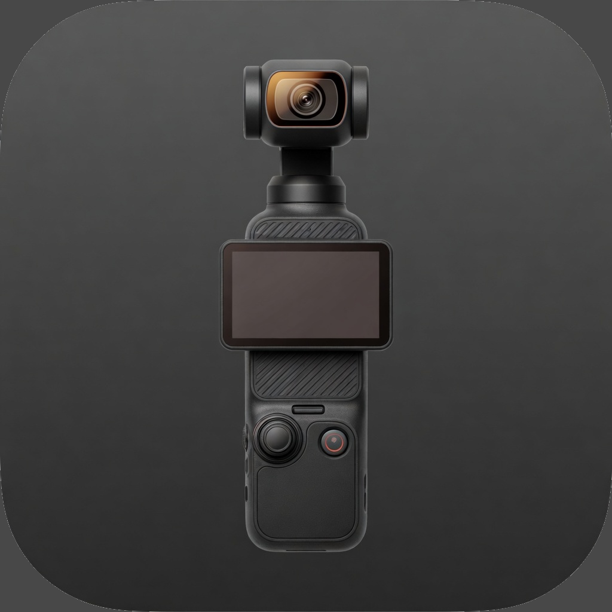

<p align="center">
  
</p>

# Pocket3 Companion

A menu-bar app for aiming a DJI Osmo Pocket 3 from a Mac while the camera is in webcam mode. Pan, tilt, and zoom go over USB. The picture stays in whatever app is using the camera, such as OBS.

This project is not affiliated with DJI.

## What you need

- An Apple silicon or Intel Mac on macOS 14 or later.
- The Pocket 3 plugged into USB-C, with **Webcam** chosen on the camera. In that mode it does not show up as a disk.
- The Xcode command-line tools, only if you build it yourself.

The app does not open by itself when you plug the camera in. Open it once. It then stays in the menu bar until you quit it, and it reconnects when the camera comes back.

## Install

1. Download the zip for that Mac from [Releases](https://github.com/slelham/pocket3-companion/releases/latest). Apple silicon is `Pocket3Companion-1.1.0-mac-arm64.zip`. Intel is `Pocket3Companion-1.1.0-mac-x86_64.zip`.
2. Unzip it and move **Pocket3 Companion** to `/Applications`.
3. The first time, macOS will block it. The app is signed on the machine that built it, not by Apple. Right-click the app, choose **Open**, and confirm. If that is not offered, go to **System Settings → Privacy & Security** and choose **Open Anyway**.
4. Open the app. A viewfinder icon appears in the menu bar. The app has no Dock icon.

Plug in the Pocket 3 and tap **Webcam** on its screen. The dot in the panel turns green and says **Webcam connected**.

## Controls

Click the menu-bar icon.

| Control | What it does |
| --- | --- |
| Pad | Aims the camera. The center of the pad is straight ahead, about 45° of pan and 40° of tilt either way. |
| Arrows | Step by 1°, 5°, or 15°. These can walk past the pad, out to the gimbal’s full range. |
| Scope button | Returns to the saved center. |
| Set as Center | Saves the current angle as that center. |
| Invert Pan | Swaps left and right. |
| 1×, 1.5×, 2× | Zoom presets. The lens is 1× at the wide end and 4× at the far end of the slider. |
| − and + | Zoom by 0.25×. The slider moves in smaller steps. |
| Presets | Up to twenty saved pan, tilt, and zoom framings. **Add Preset** stores the current one. Click a preset to recall it. **Move** walks there. **Jump** sends the angle at once. Choosing another preset replaces a move that is still running. |
| 15°/s and 32°/s | Speed of a move, a held key, and recenter. A preset can keep its own speeds. |
| Scope button | Moves back to the saved center at that speed. Esc stops the move. |
| Stop | Stops scheduling pan, tilt, and zoom. Esc does the same when the panel has the keyboard. |
| Simple / Advanced | Advanced adds roll, focus, and sliders for the full pan and tilt range. |
| Live preview | Optional picture inside the panel. The frame is the whole camera picture. Leave it off if OBS or another app is using the camera. |
| Resolution | Wide 1080 or 4K for that preview. The box stays the same size. The line under the control is the size and frame rate the camera is delivering. 4K is the sharper frame, at 30 fps or below. OBS keeps the resolution set on its source. |
| Pop out | Moves the whole panel into a window that stays on the desktop. Dock, or the window's close button, puts it back in the menu. |

From any app:

| Keys | Action |
| --- | --- |
| ⌃⌥ and an arrow | Step |
| ⌃⌥C | Saved center |
| ⌃⌥− and ⌃⌥= | Zoom out and in. The keypad minus and plus keys do the same. |
| ⌃⌥0 or ⌃⌥1 | 1× |
| ⌃⌥2 | 1.5× |
| ⌃⌥3 | 2× |

With the panel in front, hold **W A S D** to tilt and pan, **Q E Z X** for the diagonals, and **↑ ↓** to zoom. Release a key to stop that direction. **Esc** stops scheduling. These keys stay out of text fields.

The number next to Zoom is the lens position the camera is reporting, so it catches up after you click.

## Presets and other software

Presets stay on this Mac. **Preset tools → Export** writes a JSON file, and **Import** adds presets from one until the list is full.

**Local control** listens on `127.0.0.1:47323` only. It is off until you turn it on. Requests need the key in a header, `Authorization: Bearer …` or `X-Pocket3-Key`. The panel copies a ready-to-run command. Empty slots do nothing.

```sh
curl -s http://127.0.0.1:47323/v1/status -H "Authorization: Bearer KEY"
curl -s http://127.0.0.1:47323/v1/presets -H "Authorization: Bearer KEY"
curl -s -X POST http://127.0.0.1:47323/v1/presets/1/recall -H "Authorization: Bearer KEY"
curl -s -X POST http://127.0.0.1:47323/v1/recenter -H "Authorization: Bearer KEY"
curl -s -X POST http://127.0.0.1:47323/v1/stop -H "Authorization: Bearer KEY"
```

**Stream Deck** 6.6 or later uses that same connection. In Preset tools, **Install** pairs this Mac and opens the plugin. Stream Deck then asks you to confirm it. **Connect** pairs again. **Disconnect** stops the deck until the next Connect. The plugin has no key to paste in, and a new curl key does not disconnect it.

Recall Preset lists the preset names. Renaming or reordering a preset keeps the key on that preset. A deleted preset does nothing. Pan / Tilt and Zoom move while the key is held and stop when you let go. Several of those keys can be held at once. Recenter walks to the saved center. Stop drops pan, tilt, and zoom that have not been sent.

## If it will not move

Zoom can still work when the gimbal will not.

- Press the joystick once. Pressing and holding it locks the gimbal, and a lock ignores pan and tilt from the computer.
- Turn ActiveTrack off on the camera. It will hold the subject and fight these controls.
- Gimbal mode (Follow, Tilt Lock, FPV) is chosen on the camera. Webcam mode does not switch it.

## How it works

In webcam mode the Pocket 3 is a standard USB video camera, vendor `0x2ca3`, product `0x0023`. macOS claims the video interface, so the usual USB libraries cannot send camera controls. This app sends USB Video Class requests with IOKit without taking that interface away from OBS or any other app.

| Control | Selector | Value |
| --- | --- | --- |
| Zoom absolute | `0x0B` | 100 wide through 400 full, on this camera |
| Pan and tilt absolute | `0x0D` | 8 bytes, two signed 32-bit arcseconds (3600 per degree) |
| Roll absolute | `0x0F` | Degrees, about −30 to +30 on this camera |
| Focus absolute | `0x06` | 0 through 4095. Selector `0x08` is only an autofocus flag. On this camera it does not hunt, so the app tries a focus move and says so when the lens stays put. |

Relative pan and tilt are not supported. The camera reports a range of about −35° to 215° of pan and −90° to 90° of tilt, in 1° steps. The wide pan range is what lets the head face the other way. The pad only covers the forward view so that straight ahead sits in the middle.

One pan or tilt command often stops short. The app repeats the aim until the camera reports it is within half a degree, so a 1° step is actually sent, or until the gimbal stops moving. Zoom is different: one command is enough, and the lens reports the new stop about 400ms later. Sending zoom again on every frame holds the lens where it is, which is why zoom out used to fail.

Exposure, white balance, and the record button are not on this USB connection. Those stay on the camera. Recording to the card is the shutter button, with a microSD card in and the webcam output at 1080p.

There is also a small command-line tool, `pocket3-companion`, installed to `~/.local/bin` when you build from source. Add that directory to your `PATH` if you want it in a terminal.

```sh
pocket3-companion                  # print pan, tilt, and zoom
pocket3-companion set 0 0         # aim, in degrees
pocket3-companion nudge -5 0      # step
pocket3-companion zoom 150        # 1.5×
pocket3-companion zoom in         # 0.25×
pocket3-companion zoom out
pocket3-companion roll 0          # level the horizon
pocket3-companion focus auto
pocket3-companion focus 1200      # manual focus
```

## Build

Install the Xcode command-line tools, then:

```sh
git clone https://github.com/slelham/pocket3-companion.git
cd pocket3-companion
./build.sh
```

`clang` and `swiftc` are enough. Xcode itself is not required. The build also packs the Stream Deck plugin into the app.

## Support

The app is free. If it saves you time, you can tip on [Venmo @slelham](https://venmo.com/u/slelham).

## Thanks

The USB pan and tilt request follows [gimbal-bar](https://github.com/amirmxt/gimbal-bar) by amirmxt, which is MIT licensed. This project is a separate app: it adds zoom, presets, a Stream Deck plugin, and the follow-through that keeps sending an aim until the gimbal arrives.
